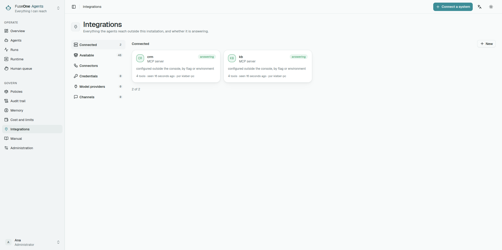
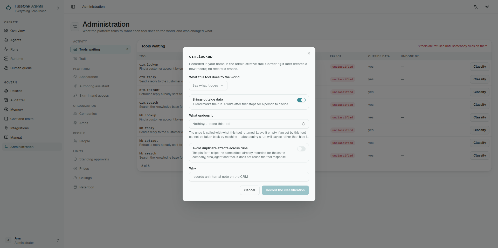

## The catalogue is a recipe, not a connector

A recipe says how a server is usually reached, which credentials it expects
and which tools its documentation publishes. It is not endorsement and it does
not apply trust by itself.

Connecting does not classify. Classifying does not bring a tool into the
surface. A credential does not narrow reach. They are three different
decisions.

## Transport

| Transport | When to use it | Care |
|---|---|---|
| Remote HTTP | Preferred in production | The platform sends only the configured credential |
| Local stdio | Useful for development or servers with no remote option | Runs as the worker, inside the worker container |

A stdio server does not inherit the worker environment. It receives only the
platform allowlist and the variables configured for it. If it needs a file,
the platform seals the content, materialises it in a 0700 directory with a
0600 file, and removes it when the process stops.

## Surface

The surface says which tools from this server exist for this installation.
Outside the surface a tool is not forbidden: it does not exist for agents.

A new tool on a server with a chosen surface starts outside the surface. That
is the safe behaviour: novelty does not enter reach by accident.

## Classification

Each tool needs a Curator decision:

- effect: read, write, destructive or financial;
- whether the result is untrusted;
- which tool compensates it, when one exists.

The decision carries the digest of the definition that was judged. If the
server changes a tool's schema or description, the old decision becomes stale
and the Gate refuses until a fresh review.

The catalogue only grows. Discovery records the tools it finds and never
removes one it no longer sees, and deleting a server leaves its tools listed
(#219). After narrowing what a server offers — a smaller toolset, a different
account — check its discovered tools before trusting a publish: the publish
check accepts a tool the catalogue still remembers even if the server stopped
offering it.

## Installation credential

Use an installation credential when the server acts as a service account:
discovery, health checks, probes and tools that do not represent a particular
person.

That credential is shared by every run that uses the server in that mode. If
the token reaches the whole account, the platform cannot narrow it; surface
and classification only control what agents may try.

## Personal credential

Use a personal credential when the server expects user authority: Google
Workspace, Slack OAuth, personal GitHub, Atlassian and similar cases.

The credential is sealed by server and principal. A run can use it only when
it carries `OnBehalfOf` for that principal. Scheduled runs have no person; if
the recipe says the credential is personal, they stop instead of falling back
to the installation credential.

## GitHub App

A GitHub server can authenticate as a **GitHub App** instead of with a token.
The server then acts as the App, not as a person: what it may do is the App's
permissions and the repositories its installation was given, and comments and
reviews it writes are signed by the App.

What to configure, in the server's credential panel or when connecting from
the catalogue:

| Field | What it is |
|---|---|
| App id | The number on the App's settings page |
| Installation id | The installation of that App on the organisation or account |
| Private key | The `.pem` generated in the App's settings, pasted or uploaded |
| Repositories (optional) | Narrows each token to these repositories; blank means everything the installation was given |
| API base URL (optional) | Blank for github.com; `https://HOST/api/v3` for GitHub Enterprise Server |
| Toolsets (optional) | Sent as `X-MCP-Toolsets`, for the hosted GitHub MCP server |

The key is sealed in the vault. Once saved, the screen only says that a key
is configured, and leaving the field blank keeps it. The administration trail
records that the App credential changed, never the key.

The worker turns the key into installation tokens: it signs a short-lived JWT,
exchanges it with GitHub for a token, keeps that token in memory only and
replaces it five minutes before it expires. When minting fails, the worker
keeps a token that is still valid, and waits 15 seconds before asking GitHub
again, so a GitHub outage does not become a flood of requests. A failure shows
the server as unavailable with a fixed reason — key refused, installation not
found, repository outside the installation — that never carries the key or the
token.

Rules that hold while the App is set:

- **HTTPS only.** The server URL and the API base URL must be `https://`;
  plain `http://` is accepted only to loopback (`localhost`, `127.0.0.1`,
  `::1`). Every request carries the App's JWT or its token.
- **No redirect carries a secret.** Minting does not follow redirects, and an
  MCP redirect to another scheme, host or port is refused before a token is
  attached.
- **The App is the identity for everyone.** No personal credential is looked
  up for the server, and the screen refuses to save one. If a policy requires a
  personal credential for this server's tool calls, those calls are refused,
  because the App cannot satisfy it; discovery still runs as the App.
- **Headers configure, they do not authenticate.** Configuration headers can
  sit beside the App — the hosted GitHub server needs `X-MCP-Toolsets` to offer
  more than its default sets, and `projects` is not in them. `Authorization`
  and `Proxy-Authorization` are refused, in any letter case, and the runtime
  strips them before setting the App's token.

## Authentication shapes

The catalogue declares the shape, but the runtime sends only what was
configured.

| Shape | What to configure |
|---|---|
| Bearer | Simple token |
| Header | One or more exact headers required by the server |
| OAuth | Access token, refresh token, token URL, client id and secret |
| GitHub App | App id, installation id and private key (above) |
| Basic | Ready-made header, when the server expects Basic |
| DSN | Connection string |
| Env | Variables for stdio |
| Config file | Sealed document materialised in the worker |

Do not fill two shapes at the same time. The screen refuses that so a person
does not configure one thing while the runtime sends another. The one
combination allowed is a GitHub App with configuration headers beside it, and
only because those headers cannot carry a credential.

## Result cache

A server can cache successful read-only results for a short TTL. Use it for
stable, repeated reads such as "list datasources" or "fetch the same runbook",
not for data that must be fresh on every call.

The cache lives in each worker process, not in a shared store. With two
workers, either worker may miss until it has seen the same read. A cache hit
still writes a fresh content reference for the current run and the trail says
which earlier run and step supplied the bytes.

The cache key includes the tool definition, arguments, scope and `OnBehalfOf`.
That keeps a personal credential result with the person who produced it.

## Quick diagnosis

- Server is "answering" but a tool fails with personal credential: configure
  the credential in Credentials for the user that started the run.
- Tool is classified but the Gate refuses: check stale digest or whether the
  tool is outside the surface.
- HTTP MCP fails on protocol: set the server protocol mode to legacy when the
  recipe or server requires it.
- stdio does not start after an upgrade: explicitly accept local execution.
