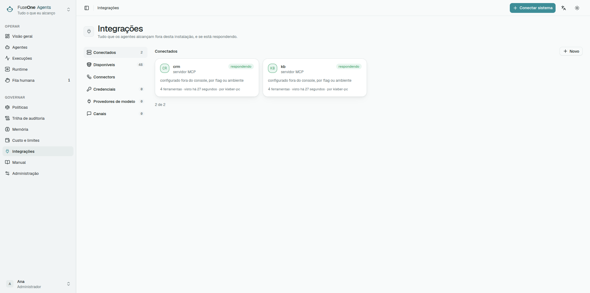
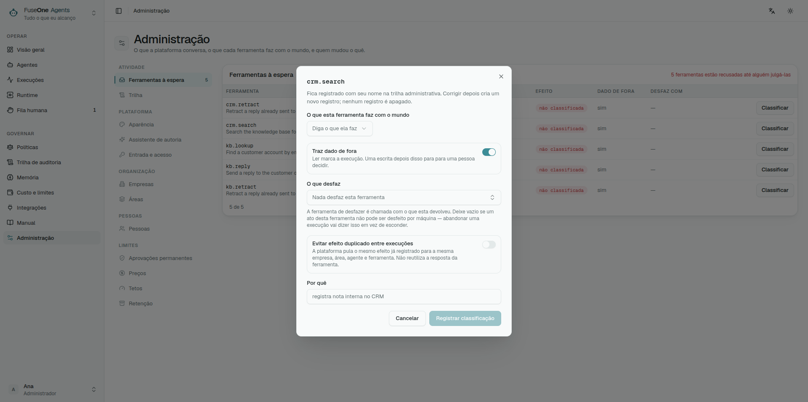

## O catálogo é receita, não conector

Uma receita diz como um servidor costuma ser alcançado, quais credenciais ele
espera e quais ferramentas a documentação publica. Ela não é homologação e não
aplica confiança sozinha.

Conectar não classifica. Classificar não traz ferramenta para a superfície.
Credencial não estreita alcance. São três decisões diferentes.

## Transporte

| Transporte | Quando usar | Cuidado |
|---|---|---|
| HTTP remoto | Preferido em produção | A plataforma envia só a credencial configurada |
| stdio local | Útil para desenvolvimento ou servidor sem remoto | Roda como o worker, dentro do container do worker |

Servidor stdio não herda o ambiente do worker. Ele recebe só a allowlist da
plataforma e as variáveis configuradas para ele. Se precisar de arquivo, a
plataforma sela o conteúdo, materializa em diretório 0700 com arquivo 0600, e
remove quando o processo termina.

## Superfície

A superfície diz quais ferramentas deste servidor existem para esta
instalação. Fora da superfície a ferramenta não é proibida: ela não existe para
os agentes.

Uma ferramenta nova em servidor com superfície escolhida nasce fora. Isso é o
comportamento seguro: novidade não entra no alcance por acidente.

## Classificação

Cada ferramenta precisa de uma decisão do Curador:

- efeito: read, write, destructive ou financial;
- se o resultado é untrusted;
- qual ferramenta compensa, quando houver.

A decisão carrega o digest da definição julgada. Se o servidor mudar schema ou
descrição da ferramenta, a decisão antiga fica stale e o Gate recusa até nova
revisão.

O catálogo só cresce. A descoberta registra as ferramentas que encontra e
nunca remove uma que deixou de ver, e apagar um servidor deixa as ferramentas
dele na lista (#219). Depois de estreitar o que um servidor oferece — um
toolset menor, outra conta —, confira as ferramentas descobertas antes de
confiar numa publicação: a checagem da publicação aceita uma ferramenta que o
catálogo ainda lembra, mesmo que o servidor tenha deixado de oferecê-la.

## Credencial da instalação

Use credencial da instalação quando o servidor age como uma conta de serviço:
discovery, health checks, probes e ferramentas que não representam uma pessoa
específica.

Essa credencial é compartilhada por todas as runs que usam o servidor nesse
modo. Se o token alcança a conta inteira, a plataforma não consegue estreitar
isso; a superfície e a classificação só controlam o que os agentes podem
tentar.

## Credencial pessoal

Use credencial pessoal quando o servidor espera autoridade de usuário: Google
Workspace, Slack OAuth, GitHub pessoal, Atlassian e casos parecidos.

A credencial é selada por servidor e principal. Uma run só consegue usá-la se
carrega `OnBehalfOf` daquele principal. Runs agendadas não têm pessoa; se a
receita diz que a credencial é pessoal, elas param em vez de cair para a
credencial da instalação.

## GitHub App

Um servidor do GitHub pode se autenticar como um **GitHub App** em vez de usar
um token. O servidor passa a agir como o App, não como uma pessoa: o que ele
pode fazer são as permissões do App e os repositórios que a instalação
recebeu, e os comentários e revisões que ele escreve saem assinados pelo App.

O que configurar, no painel de credencial do servidor ou ao conectar pelo
catálogo:

| Campo | O que é |
|---|---|
| ID do App | O número na página de configurações do App |
| ID da instalação | A instalação desse App na organização ou na conta |
| Chave privada | O `.pem` gerado nas configurações do App, colado ou enviado como arquivo |
| Repositórios (opcional) | Restringe cada token a esses repositórios; em branco vale tudo o que a instalação recebeu |
| URL base da API (opcional) | Em branco para github.com; `https://HOST/api/v3` no GitHub Enterprise Server |
| Toolsets (opcional) | Enviado como `X-MCP-Toolsets`, para o GitHub MCP hospedado |

A chave fica selada no cofre. Depois de salva, a tela só informa que há uma
chave configurada, e deixar o campo em branco mantém a que está guardada. A
trilha da administração registra que a credencial do App mudou, nunca a chave.

O worker transforma a chave em tokens de instalação: assina um JWT de vida
curta, troca esse JWT por um token no GitHub, guarda o token só em memória e o
substitui cinco minutos antes de expirar. Quando a geração falha, o worker
continua usando um token que ainda vale e espera 15 segundos antes de pedir
de novo ao GitHub, para que uma instabilidade do GitHub não vire uma enxurrada
de pedidos. A falha deixa o servidor indisponível com um motivo fixo — chave
recusada, instalação não encontrada, repositório fora da instalação — que
nunca traz a chave nem o token.

Regras que valem enquanto o App estiver configurado:

- **Só HTTPS.** A URL do servidor e a URL base da API precisam ser
  `https://`; `http://` só é aceito em loopback (`localhost`, `127.0.0.1`,
  `::1`). Toda requisição leva o JWT ou o token do App.
- **Nenhum redirect leva segredo.** A geração do token não segue redirects, e
  um redirect do MCP para outro esquema, host ou porta é recusado antes de o
  token ser anexado.
- **O App é a identidade para todo mundo.** Nenhuma credencial pessoal é
  consultada para o servidor, e a tela recusa salvar uma. Se uma política exige
  credencial pessoal nas chamadas de ferramenta desse servidor, essas chamadas
  são recusadas, porque o App não tem como atender; a descoberta continua
  rodando como o App.
- **Cabeçalhos configuram, não autenticam.** Ao lado do App, só são aceitos os
  cabeçalhos de configuração documentados do GitHub MCP hospedado, com
  qualquer combinação de maiúsculas e minúsculas: `X-MCP-Toolsets`,
  `X-MCP-Tools`, `X-MCP-Readonly`, `X-MCP-Lockdown` e `X-MCP-Insiders`. O
  servidor hospedado precisa de `X-MCP-Toolsets` para oferecer mais do que os
  conjuntos padrão, e `projects` não está entre eles. Qualquer outro
  cabeçalho — `Authorization`, uma chave de API, um cookie — é recusado ao
  salvar, e o runtime o descarta de um registro salvo antes, então só o token
  do App identifica a requisição.
- **Remover o App remove os cabeçalhos dele.** Os cabeçalhos que estavam ao
  lado saem junto; nunca viram uma credencial de cabeçalho própria.

## Formas de autenticação

O catálogo declara a forma, mas o runtime só envia o que foi configurado.

| Forma | O que configurar |
|---|---|
| Bearer | Token simples |
| Header | Um ou mais headers exatos exigidos pelo servidor |
| OAuth | Access token, refresh token, token URL, client id e secret |
| GitHub App | ID do App, ID da instalação e chave privada (acima) |
| Basic | Header pronto, quando o servidor espera Basic |
| DSN | String de conexão |
| Env | Variáveis para stdio |
| Config file | Documento selado materializado no worker |

Não preencha duas formas ao mesmo tempo. A tela recusa para evitar que uma
pessoa configure uma coisa e o runtime envie outra. A única combinação
permitida é um GitHub App com cabeçalhos de configuração ao lado, e só porque
esses cabeçalhos não podem levar credencial.

Informe cada cabeçalho uma vez só. Nomes de cabeçalho HTTP não diferenciam
maiúsculas de minúsculas, então `X-MCP-Readonly` e `x-mcp-readonly` são o
mesmo cabeçalho: a tela recusa as duas grafias juntas, e um servidor cujos
cabeçalhos salvos as tenham não envia requisição nenhuma, em vez de mandar um
valor que muda de uma requisição para outra.

## Cache de resultado

Um servidor pode cachear resultados de leitura bem-sucedidos por um TTL curto.
Use para leituras estáveis e repetidas, como "listar datasources" ou "buscar o
mesmo runbook", não para dados que precisam estar frescos em toda chamada.

A cache vive em cada processo de worker, não em um store compartilhado. Com
dois workers, qualquer um deles pode dar miss até ter visto a mesma leitura. Um
hit ainda grava uma referência de conteúdo nova para a run atual, e a trilha
diz qual run e passo anteriores forneceram os bytes.

A chave inclui definição da ferramenta, argumentos, escopo e `OnBehalfOf`.
Assim um resultado produzido com credencial pessoal fica com a pessoa que o
produziu.

## Diagnóstico rápido

- Servidor "answering" mas tool falha com credencial pessoal: configure a
  credencial na aba Credentials para o usuário que iniciou a run.
- Tool aparece classificada mas Gate recusa: confira digest stale ou se a
  ferramenta está fora da superfície.
- HTTP MCP falha com protocolo: altere o protocol mode do servidor para legacy
  quando a receita ou o servidor exigir.
- stdio não inicia depois de upgrade: aceite execução local explicitamente.
